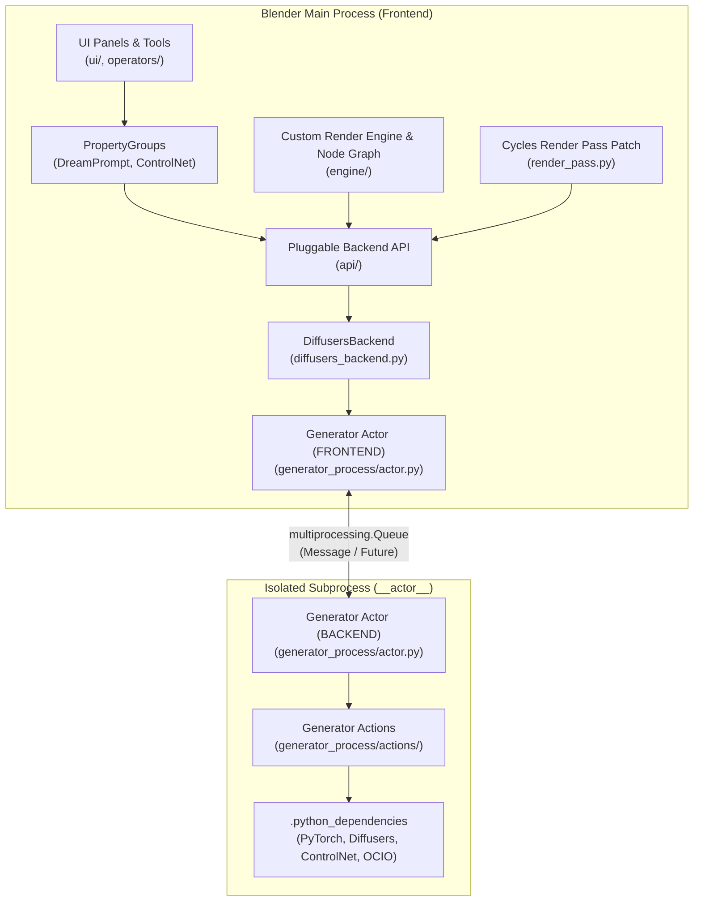
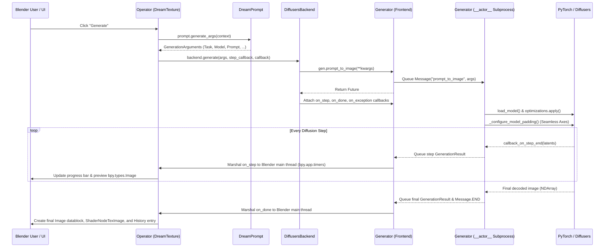

# Dream Textures Architecture

Dream Textures is a Blender add-on that integrates Stable Diffusion and related AI image generation workflows directly into Blender's Shader Editor, Image Editor, 3D Viewport, and Render Pipeline.

To prevent heavy machine learning dependencies (PyTorch, HuggingFace Diffusers, OpenCV, etc.) from polluting Blender's embedded Python runtime or blocking the UI thread, the add-on uses a **Frontend / Actor Subprocess** architecture bridged by an extensible **Backend API**.

---

## High-Level Architecture



---

## Core Architectural Pillars

### 1. Entry Point & Process Guard (`__init__.py`)
When the add-on is loaded by Blender—or re-imported by the spawned background actor process—`__init__.py` inspects `multiprocessing.current_process().name`:
- **Blender Main Process (`name != "__actor__"`)**: Clears stale module caches, registers Blender classes (`CLASSES`, `PREFERENCE_CLASSES`), workspace tools (`TOOLS`), custom `Scene` properties, presets, the custom `DreamTexturesRenderEngine`, the monkey-patched Cycles render pass, and the default `DiffusersBackend`.
- **Actor Subprocess (`name == "__actor__"`)**: Skips all `bpy` registration so the subprocess can import functions and classes from the package without requiring a full Blender UI context.

### 2. Actor Subprocess & IPC (`generator_process/`)
Heavy ML execution and dependency isolation are managed by the `Actor` pattern in `generator_process/`:
- **Dependency Isolation (`actor.py`)**: On startup, the `__actor__` process prepends `.python_dependencies` (or `.python_dependencies.zip`) to `sys.path` and configures platform-specific DLL directories (e.g., Windows `python3.dll` and MKL binaries).
- **IPC Queueing (`Actor` & `Message`)**:
  - `Generator` subclasses `Actor` and exposes generation and hub actions as methods.
  - On the `FRONTEND` (Blender), `Actor._setup()` wraps every public method into a sender function that acquires a process lock, serializes the method name and arguments into a picklable `Message`, pushes it to `_message_queue`, and returns a `Future` immediately.
  - On the `BACKEND` (Subprocess), `_backend_loop()` pulls `Message` objects from `_message_queue`, invokes the target method, and streams yielded values, results, or `TracedError` exceptions back over `_response_queue`.
- **Asynchronous `Future` (`future.py`)**:
  - Supports streaming intermediate responses (such as per-step latent previews) via `add_response_callback`, error handling via `add_exception_callback`, and completion via `add_done_callback`.
  - Automatically marshals callbacks back onto Blender's main thread using `bpy.app.timers.register` so callbacks can safely mutate `bpy.data` and tag UI regions for redraw.
  - Supports cooperative cancellation via `Message.CANCEL` checked between diffusion steps.
- **`@RunInSubprocess` Decorator (`generator_process/__init__.py`)**:
  - Allows utility functions outside of `Generator` (such as OpenImageIO resizing or OpenColorIO transforms in `image_utils.py`) to transparently delegate execution to the `__actor__` subprocess when required libraries are only installed in `.python_dependencies` or when native libraries would crash on the frontend thread.

### 3. Pluggable Backend API (`api/`, `diffusers_backend.py`)
Dream Textures decouples its Blender UI and operators from the underlying generation engine via `api.Backend`:
- **`Backend` (`api/backend/backend.py`)**: A `bpy.types.PropertyGroup` base class. Subclasses automatically register a pointer property onto `DreamPrompt` and appear in the UI backend selector. Backends implement:
  - `list_models()`, `list_controlnet_models()`, `list_schedulers()`
  - `generate(arguments: GenerationArguments, step_callback, callback)`
  - `validate(arguments: GenerationArguments)`
  - UI hooks (`draw_prompt`, `draw_advanced`, `draw_speed_optimizations`, `draw_memory_optimizations`)
- **`GenerationArguments` & `Task` (`api/models/`)**: Encapsulates all generation parameters in a typed dataclass alongside a sum-type `Task` hierarchy (`PromptToImage`, `ImageToImage`, `Inpaint`, `DepthToImage`, `Outpaint`, `Upscale`).
- **`FixItError` (`api/models/fix_it_error.py`)**: Structured validation exception raised by `Backend.validate()` (and projection validators) that embeds an interactive UI solution (`ChangeProperty`, `RunOperator`, or custom `Solution._draw`) rendered directly inside error boxes in the Blender panel.
- **`DiffusersBackend` (`diffusers_backend.py`)**: The built-in local generation backend. It translates `GenerationArguments` and hardware `Optimizations` into calls on `Generator.shared()`.

### 4. Diffusion Pipeline & Hardware Optimizations (`generator_process/actions/`, `generator_process/models/`)
- **Pipeline Caching (`actions/load_model.py`)**: Manages loaded HuggingFace Diffusers pipelines and single-file checkpoints (`.ckpt` / `.safetensors` mapped via `sd_configs/`). Evicts unused models and triggers `gc.collect()` / `torch.cuda.empty_cache()` when device, precision, or offload settings change.
- **Seamless Tiling (`actions/prompt_to_image.py`, `actions/detect_seamless/`)**:
  - Patches `nn.Conv2d` and `LoRACompatibleConv` layers in the UNet and VAE to use asymmetric circular padding along the X and/or Y axes.
  - Includes a lightweight PyTorch CNN+GRU model (`detect_seamless/model.npz`) that inspects image borders to automatically detect whether an input image is already seamless on X/Y axes (`SeamlessAxes.AUTO`).
- **Hardware & Memory Optimizations (`models/optimizations.py`, `directml_patches.py`)**:
  - Dynamically detects device capabilities (`cuda`, `mps`, `dml`, `cpu`).
  - Applies Scaled Dot-Product Attention (SDP), attention slicing, model/submodule CPU offloading via `accelerate`, channels-last memory format, VAE slicing, custom tiled VAE latent decoding (`upscale_tiler.py`), and DirectML tensor patches.

### 5. Custom Node-Based Render Engine (`engine/`)
Dream Textures registers a standalone Blender Render Engine (`DreamTexturesRenderEngine`, `bl_idname = "DREAM_TEXTURES"`) backed by a custom node graph (`DreamTexturesNodeTree`):
- **Execution Model (`engine/node_executor.py`)**: Evaluates the node graph lazily starting from `GROUP_OUTPUT`, caching intermediate node outputs per render pass and reporting node progress to Blender's render stats.
- **Node Categories (`engine/nodes/`)**:
  - **Pipeline Nodes (`pipeline_nodes.py`)**: `NodeStableDiffusion` (executes diffusion tasks) and `NodeControlNet` (binds scene collections or images to ControlNet models).
  - **Annotation Nodes & Renderers (`annotation_nodes.py`, `engine/annotations/`)**: Offscreen GPU (`gpu.types.GPUOffScreen`) and scene renderers that generate conditioning maps directly from 3D scene geometry:
    - **Depth (`depth.py`)**: Renders normalized Z-depth buffers using Blender's `gpu` module.
    - **Normal (`normal.py`)**: Renders world/camera-space normal maps.
    - **OpenPose (`openpose.py`)**: Projects tagged Blender Armature bones (`ArmatureOpenPoseData`, `BoneOpenPoseData`) into 2D OpenPose rig skeletons.
    - **ADE20K (`ade20k.py`)**: Renders semantic segmentation color maps from tagged scene objects (`ObjectADE20KData`).
    - **Viewport (`viewport.py`)**: Captures OpenGL viewport renders.
  - **Input & Utility Nodes (`input_nodes.py`, `utility_nodes.py`)**: Math, random seed, string manipulation, image cropping/resizing/joining, color correction, branching (`NodeSwitch`), and frame path output nodes.

### 6. 3D Texture Projection & Cycles Render Pass
- **Texture Projection (`operators/project.py`)**:
  - Projects selected edit-mode mesh faces from the active 3D Viewport camera perspective into a `"Projected UVs"` layer.
  - Captures the viewport depth buffer (and optionally viewport color), generates a texture via `DepthToImage` or a Depth `ControlNet`, and assigns a new Principled BSDF material linked to the generated image.
  - Supports **GPU UV Baking** (`bake()`): uses a custom GLSL shader in an offscreen framebuffer to remap pixels from projected screen-space UVs onto the mesh's target UV map.
- **Cycles Render Pass (`render_pass.py`)**:
  - Monkey-patches `cycles.CyclesRender.update_render_passes` and `cycles.CyclesRender.render` to inject a `"Dream Textures"` RGBA render pass.
  - Post-processes Cycles' `"Combined"` and `"Depth"` passes through `ImageToImage` or `DepthToImage` with automatic forward and inverse OpenColorIO scene color management transforms.

### 7. Image & Color Management (`image_utils.py`)
Centralizes conversions between Blender data-blocks (`bpy.types.Image`, `bpy.types.RenderPass`), NumPy `NDArray` (`HW`, `HWC`, `NHWC`), PIL images, and disk paths:
- Uses Blender's fast `foreach_get` / `foreach_set` APIs for pixel transfer.
- Re-implements Blender's display/view color management pipeline via `PyOpenColorIO` (exposure, gamma, look, view transform, display device, and inverse transforms) and offloads transformations or `OpenImageIO` operations to the actor subprocess when needed.

---

## Directory & Module Map

```text
dream-textures/
├── __init__.py                 # Add-on entry point, process guard, registration
├── classes.py                  # Central registry of Blender Operators, Panels, and PropertyGroups
├── preferences.py              # Add-on preferences, HuggingFace Hub search/download, checkpoint linking
├── diffusers_backend.py        # Default local HuggingFace Diffusers Backend implementation
├── prompt_engineering.py       # Composable prompt structure templates and token definitions
├── image_utils.py              # NumPy <-> Blender/PIL/OIIO image conversions & OCIO color transforms
├── render_pass.py              # Cycles render engine monkey-patch for the Dream Textures render pass
├── realtime_viewport.py        # Experimental real-time viewport rendering hook (in development)
├── tools.py                    # Workspace tool registry (InpaintAreaBrush)
├── api/                        # Public Backend API for built-in and third-party backends
│   ├── backend/                # Backend PropertyGroup base class
│   └── models/                 # GenerationArguments, Task sum types, FixItError, GenerationResult
├── generator_process/          # Background subprocess Actor framework and ML actions
│   ├── actor.py                # Multiprocessing Queue IPC, dependency loader, Actor base class
│   ├── future.py               # Thread-safe Future with Blender main-thread callback marshaling
│   ├── directml_patches.py     # Runtime monkey-patches for DirectML tensor operations
│   ├── actions/                # Subprocess actions (prompt_to_image, inpaint, control_net, upscale, etc.)
│   └── models/                 # Checkpoint, ModelType, ModelConfig, Optimizations, Scheduler, UpscaleTiler
├── engine/                     # Custom Dream Textures RenderEngine and Node Graph system
│   ├── engine.py               # DreamTexturesRenderEngine & armature/object property panels
│   ├── node_tree.py            # DreamTexturesNodeTree definition
│   ├── node_executor.py        # Lazy DAG evaluator for the render node tree
│   ├── nodes/                  # Pipeline, Input, Annotation, and Utility nodes
│   └── annotations/            # Offscreen GPU renderers for Depth, Normal, OpenPose, ADE20K, Viewport
├── operators/                  # Blender operators (DreamTexture, ProjectDreamTexture, Upscale, History, etc.)
├── property_groups/            # Blender PropertyGroups (DreamPrompt, ControlNet, SeamlessResult)
├── ui/                         # Sidebar panels across spaces (Image, Shader, 3D View, Render) & Presets
├── sd_configs/                 # Reference YAML configs for single-file SD 1.5, 2.x, SDXL, and ControlNet
├── builtin_presets/            # Default advanced configuration presets (Preview, Final, Debug)
├── community_backends/         # Example template for external Backend implementations
├── requirements/               # Platform-specific pip requirement lockfiles (CUDA, MPS, ROCm, DirectML)
└── scripts/                    # Developer scripts (dependency zipping, seamless detector training)
```

---

## End-to-End Generation Data Flow


